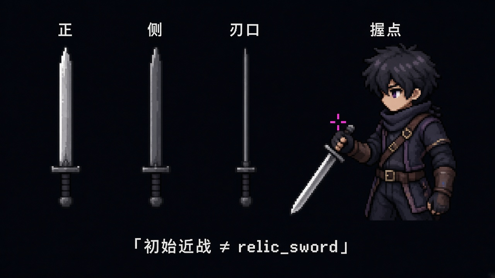

# 初始近战武器（已锁）

2026-10-15 锁定。开场近战只用这一把。刀形的唯一依据是下面这张形制图。2026-09-26 的 `slash` / `idle` 导出是弯刃，已经撤下，不能当第二套依据。

这不是 `relic_sword`。`relic_sword` 是祁霜的旧练习剑，只用于 0B 献祭演出和未完之约的刺击外观。初始近战不得画成那把练习剑，也不得共用它的 id。

## 形制

- **类型：** 单手直刃（非阔刀、非仪式长剑）。
- **比例：** 刃厚全长一致。刃长以已过闸的[形制图](形制/初始近战-三视握点.jpg)示意为准。
- **结构：** 小护手，无夸张装饰。握点在护手后（示意粉十字）。coding 写死手→刃根挂点常量，`slash` / `run` / `jump` 共用。

初始近战三视+握点（刃厚全长一致；≠ relic_sword）

姿势会改绝对坐标。刃长、刃厚、护手和握点只认形制图。

## 已撤样板的像素对照（不作形制依据）

下表量的是已经撤下的 2026-09-26 弯刃导出，只留下当时的网格数字。那些 PNG 已不在 `v4/godot/assets/`。不要用这张表改刀。

| 量 | 导出像素 | 说明 |
| --- | --- | --- |
| 角色身高 | 229 px | 帧 01：头顶 y=17，脚底基线 y=246 |
| 刃 | (270, 90) → (337, 89) | 帧 05。护手刃侧到刃尖，刃长约 67 px，约为身高的 0.29 |
| 刃厚 | 中段 8 px | 帧 05，x=272–310，y 约 87–94。尖端像素变薄是这批连续调取样的收尖；锁的是形制图上的刃厚全长一致 |
| 护手 | x=262–269，y=80–101 | 帧 05。沿刃方向宽约 8 px，比刃身上下各多出一截。无纹饰 |
| 握点 | (258, 90) | 护手靠握把的一侧是 x=262。再向握把方向一指 |

帧 01 的剑是斜向下的，刃长约 70 px，和帧 05 是同一把。

这批帧是连续调，手指没有分开的像素边。一指按帧 05 握拳沿刃方向厚度的大约四分之一估算，约 4 导出像素（源图约 16 px）。握点因此落在 (258, 90)。

下一版帧须符合形制图，并经现行 22 色板（方案 B）导出。旧 `slash` 已撤，不再当作同刀参照。设定条文见[技能总览 · 初始近战形制（已锁）](../设定/技能总览.md#初始近战形制已锁)。

## 攻击出帧（已锁）

2026-10-19 锁定。近战 `slash` 的画面母版只走这条制作路径。轴心、脚钉、格数和帧率不在这里写，见[程序接口 · 挂帧约定](../设定/程序接口-挂帧约定.md)。

程序化棒人姿态板（7 格）锁定动作 → Aseprite 手绘分层（`body` / `sword_arm` / `free_arm`）→ 姿势对节拍 → 烘帧。

不得把下列任何一种当成 `slash` 母版：逐帧自由 AI 重绘再合成、只交 AI 姿态板、自动蒙版、图生视频抽帧。

`idle` / `run` / `jump` 以后可以试视频抽帧，并做待机钉扎，只当草稿，不进这条母版。挂上画面仍走挂帧约定。

此前所有由 AI 生成、且曾被认可的 `idle` / `slash` 样板，于 2026-10-19 全部退役。新的静帧种子须重过可见件闸，并看见：右鬓银白、胸口环状缝合痕、腰匣四芯色序、右绷左腕、直刃矩护手。件数与色序以[角色视觉锚点 · 可见件清单](角色视觉锚点.md#可见件清单同人闸)为准，刀形仍只认本页形制图。

冷却、资源、伤害不在这里定。
