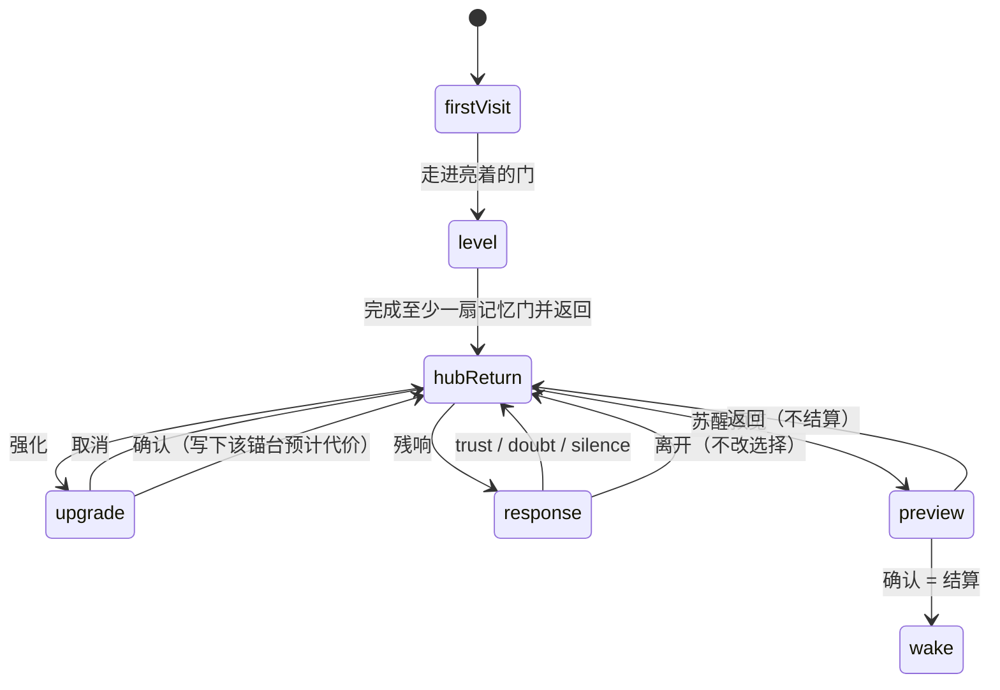

# 回点 HUD 线框

> **用途：** 给 UI 的分区草案。画的是《四烛》全文里的回点（枢纽），不是另一套 Demo 界面。Demo 只验收这条线的前两站：初访，以及盾痕结束后回到同一画面。
>
> **权威：** 规则以[故事框架](../设定/故事框架.md)为准；节拍、开门顺序和残响逻辑以[关卡与场景清单](../设定/关卡与场景清单.md)为准；资产状态以[设计资产挂接](设计资产挂接.md)为准。本稿不改里程碑，不改字段含义。
>
> **本稿只出线框。** 不出像素、不切片、不写 Godot 场景。烛的正式图等现行 22 色板（方案 B）接入 `prototype/2d_pipeline/v4/build_sequence.py` 之后再排。

锚台 id：`wenlan` | `mojiu` | `xiaohe` | `qishuang`  
烛档：`full` | `waver` | `weak` | `dying`  
回应：`trust` | `doubt` | `silence`  
面板开关：`hub_panels_unlocked`

---

## 1. 画面有哪几态

回点是固定景。四支烛始终在，用来比较高度。面板按状态进出，不叠在初访上。



| 态 | `hub_panels_unlocked` | 画面里有什么 |
| --- | --- | --- |
| 初访 | 假 | 四支只读烛 + 四扇门 + 中央站位 |
| 返回枢纽底 | 真 | 同上，烛档和门按存档变；另有三个入口，内容不展开 |
| 强化确认 | 真 | 枢纽底之上，只开强化确认 |
| 残响三选一 | 真 | 枢纽底之上，只开这一座锚台的残响 |
| 苏醒预览 | 真 | 枢纽底之上，只开只读预览 |

三个入口在初访不存在。不是灰掉，也不能聚焦、不能点开。

---

## 2. 初访

还没有完成任何一扇记忆门。四支烛都是 `full`。`gate_wenlan` 亮，其余三门锁/淡。`shard_*` 都为假。`hub_panels_unlocked` 为假。

方位是线框约定，方便四支烛放在同一条脚座上比较。改左右上下不改锚台 id，也不改开门顺序。开门顺序仍是：`gate_wenlan` 初开，其后 `gate_mojiu` → `gate_xiaohe` → `gate_qishuang` → `event_hero_echo`。

```
                         qishuang
                     烛 full · 门 锁/淡
                              |
                              |
wenlan ---- 烛 full · 门 亮 -- 岑站位 -- 烛 full · 门 锁/淡 ---- mojiu
                              |
                              |
                         xiaohe
                     烛 full · 门 锁/淡
```

正视读数（四支脚座齐平，同一缩放；围圈是站位，画面上不要近大远小）：

```
  wenlan     mojiu      xiaohe     qishuang
    |          |          |          |
    |          |          |          |     ← full，四支同高
   _|_        _|_        _|_        _|_    ← 脚座一条线
  [门亮]    [门锁/淡]   [门锁/淡]   [门锁/淡]
              [ 岑 · 站在四台中间，不挡脚座 ]
```

| 位置 | 锚台 | 初访的门 |
| --- | --- | --- |
| 左 | `wenlan` 闻岚 | 实线，可进入 |
| 右 | `mojiu` 墨九 | 虚线，锁/淡 |
| 下 | `xiaohe` 小禾 | 虚线，锁/淡 |
| 上 | `qishuang` 祁霜 | 虚线，锁/淡 |

烛不是按钮。离开只走门：亮门进关（`sfx_gate_open`），锁门留在回点（`sfx_gate_locked`）。锁和亮用线型与明度分开，去色后仍能分辨，不单靠光的颜色。

碎片槽可以做在锚台上当场景空位，初访不给它控件。没有回听，没有残响立绘弹出。

这一态没有强化、没有残响三选一、没有苏醒预览，也没有地图面板。

---

## 3. 返回后 · 枢纽底

`hub_panels_unlocked` 为真之后才有这一态。完成至少一扇记忆门并回到回点时置真。Demo 走到这里时，通常是盾痕刚结束：`shard_wenlan` 为真，`relic_shield` 已在关里置真（回点不授予、不卸下），闻岚门关上，墨九门亮。墨九门在 Demo 里可以只作为下一目标，不进入。这是同一套门的数据，不是 Demo 专用布局。

例：盾痕返回（同一布局，只是这组存档）。

```
        [qishuang 烛=candle_tier]
                 门 = gate_qishuang
                        |
[wenlan 烛] —— [岑] —— [mojiu 烛]     入口·苏醒预览
 门=gate_wenlan          门=gate_mojiu   （只在本态出现，内容不展开）
 shard 真 → 入口·残响
                        |
        [xiaohe 烛=candle_tier]
                 门 = gate_xiaohe

各锚台上的「入口·强化」只在本态出现，点开后进入强化确认，不在这里展开代价。
```

三个入口各走各的态，不同时打开：

| 入口 | 出现条件 | 进入 |
| --- | --- | --- |
| 强化 | `hub_panels_unlocked` | 强化确认。点在哪座锚台，确认页就写哪座 |
| 残响 | 该锚台 `shard_*` 为真 | 残响三选一。一次只开一座 |
| 苏醒预览 | `hub_panels_unlocked` | 苏醒预览 |

`event_hero_echo` 仍按关卡清单：四枚 `shard_*` 都为真才出现。英雄回声战场不在本稿。

---

## 4. 强化确认

只在从枢纽底进入之后出现。枢纽上的四支烛还在，用来对照；残响和苏醒预览不在这一态。

```
+----------------------------------+
| 强化确认                         |
| 锚台   wenlan | mojiu | xiaohe | qishuang
| 现在   [烛]   高度 = 该锚台 candle_tier
| 预计   [烛槽] 高度待代价公式填入
|                                  |
| [取消]                  [确认]   |
+----------------------------------+
```

取消回到枢纽底，不改 `candle_tier`。确认才把预计代价写到这块锚台上，然后回到枢纽底。

预计槽用烛的高度表示，不用数值条。公式未定（随 M2 / 回点），线框不填「降几档」。盾线的强化若出现，锚台是 `wenlan`，并读取 `relic_shield`；旗标为假时不出现这条。武器形制不画。

---

## 5. 残响三选一

一次一座锚台。短残响可回听。三枚按钮只在这一态。

```
+----------------------------------+
| 残响    （当前锚台 id / 名字）    |
| 回听    shard_* 为真才可进到这里 |
|                                  |
| [信任 trust]   「我还认你这份额」 |
| [质疑 doubt]   「你凭什么用我的记忆」 |
| [沉默 silence]  未表态            |
|                                  |
| [离开]  不改当前选择              |
+----------------------------------+
```

引号里的短句来自[关卡清单 §5](../设定/关卡与场景清单.md)，作按钮旁的叙事占位。逻辑效果（信任略缓、质疑略促、沉默中性）留在该节，画面上不画抗性、不画数值。

选定一枚后回到枢纽底。离开不写选择。每座锚台一条，可以再进来改。初访进不了这一态。这一态也不是苏醒预览。

---

## 6. 苏醒预览

只读。四支烛用现在的 `candle_tier` 再画一遍，脚座仍然齐平。确认 = 结算。返回 = 回到枢纽底，不结算。

```
+------------------------------------------+
| 苏醒预览（只读）                          |
|                                          |
|  wenlan   mojiu   xiaohe   qishuang      |
|  [烛]     [烛]    [烛]     [烛]          |
|  脚座齐平，高度 = 各自 candle_tier        |
|                                          |
|  预计结果  [ 一句文案 ]                   |
|                                          |
| [返回]                          [确认]   |
+------------------------------------------+
```

结果槽只显示一句，文案来自[故事框架](../设定/故事框架.md)苏醒表的三种累积结果：四烛消耗较均衡 / 消耗明显偏向一人 / 一支烛火近乎熄灭。玩家不能在这里挑一句，也不能重新分配记忆。哪一句由以后的结算填，本稿不写公式。

这一页没有 `trust` / `doubt` / `silence`，没有回应抗性，没有抗性条。

---

## 7. 字段绑定

UI 只读或只写下表这些。不新造 `memory_shard`。回应的取值域沿用关卡清单，本稿不另起字段名。

| 画面元素 | 绑定 | 初访 | 返回后 |
| --- | --- | --- | --- |
| 闻岚烛高度 | `candle_tier` · `wenlan` = `full\|waver\|weak\|dying` | 读，`full` | 读 |
| 墨九烛高度 | `candle_tier` · `mojiu` | 读，`full` | 读 |
| 小禾烛高度 | `candle_tier` · `xiaohe` | 读，`full` | 读 |
| 祁霜烛高度 | `candle_tier` · `qishuang` | 读，`full` | 读 |
| 闻岚门 | `gate_wenlan` | 亮 | 读。盾痕返回的例子：关 |
| 墨九门 | `gate_mojiu` | 锁/淡 | 读。盾痕返回的例子：亮，Demo 可不进 |
| 小禾门 | `gate_xiaohe` | 锁/淡 | 读 |
| 祁霜门 | `gate_qishuang` | 锁/淡 | 读 |
| 英雄回声入口 | `event_hero_echo` | 无 | 四枚 `shard_*` 都为真才出现 |
| 强化 / 残响 / 预览是否存在 | `hub_panels_unlocked` | 假，三块都不放置 | 真，分态进入 |
| 闻岚回听 | `shard_wenlan` | 无入口 | 真 → 可进该座残响 |
| 墨九回听 | `shard_mojiu` | 无入口 | 同上 |
| 小禾回听 | `shard_xiaohe` | 无入口 | 同上 |
| 祁霜回听 | `shard_qishuang` | 无入口 | 同上 |
| 盾线强化能否点名 | `relic_shield` | 不出现 | 确认态读取；回点不写这面旗标 |
| 残响三钮 | 该锚台的 `trust\|doubt\|silence` | 不出现 | 只在残响态写入 |
| 预览四烛与预计结果 | 四支 `candle_tier`；结果文案槽 | 不出现 | 只读。无回应抗性字段 |
| 预览「确认」 | 结算 | 不出现 | 只在预览态，确认 = 结算 |
| 强化「取消」 | 不写 `candle_tier` | 不出现 | 只在强化态 |
| 走进亮门 | `sfx_gate_open` | 有 | 有 |
| 撞上锁门 | `sfx_gate_locked` | 有 | 有 |
| 烛声 | `sfx_candle_crackle` | 疏密随档位，间隔另定 | 同左 |

`candle_tier` 按锚台各存一档。UI 不展示百分比，也不另做一条资源槽。

---

## 8. 烛档（给以后的图）

高度差是第一阅读。去色之后仍要能分开四档。焰形、疏密只作辅助，不能单独承担档位。不画数值条。

下图的格数是线框单位，不是像素，也不是导出尺寸。正式切片等色板门禁，不在本稿交付。

```
full     waver    weak     dying
 █        █        █        █
 █        █        █        └─
 █        █        └─
 █        └─
 └─       脚座同一条线
 4        3        2        1
```

| 档 | 名字 | 线框高度 | 轮廓 | 灰度 |
| --- | --- | --- | --- | --- |
| `full` | 完整 | 4 | 焰柱最高，顶齐 | 亮块最大 |
| `waver` | 摇晃 | 3 | 顶可以不齐，整段仍矮于 `full` | 不靠色相区分 |
| `weak` | 微弱 | 2 | 细、短 | 亮块明显更小 |
| `dying` | 近熄 | 1 | 短余烬；台座还在，不要画成空位 | 仍能认出是烛 |

初访四支同为高度 4，先让玩家看见「完整」再看见落差。`sfx_candle_crackle` 随档变疏密，疏密的具体间隔不在本稿。

---

## 9. 地图（推迟，不在本稿）

地图按全文分期，见[玩法探索](../设定/玩法探索.md)和[地图显影界面](动作/界面/2026-09-25-地图显影界面.md)。早期入口灰置，或只留小地图；全屏地图后期再开。显影也不提前到开场。

回点这五态都不画地图面板，也不留全屏地图入口。

---

## 10. Beat 0C 教学提示条（另节，占位）

这条不在回点画面上。它是结界初醒（Beat 0C）的一条提示，顺序跟[关卡清单 Beat 0C](../设定/关卡与场景清单.md#beat-0c--结界初醒与教学--demo--对应-m1)一致，不是[设计资产挂接](设计资产挂接.md)里的排帧顺序。排帧把已有的 `slash` 另计；提示条仍把斩放在闪前面。

```
+------+------+------+--------+------+------+
|  跑  |  跳  |  落  |  落地  |  斩  |  闪  |
| run  | jump | fall | land   | slash| dodge|
+------+------+------+--------+------+------+
```

| 序 | 提示 | clip | 以后绑定 |
| --- | --- | --- | --- |
| 1 | 跑 | `run` | `tut_*`（例 `tut_run_started`） |
| 2 | 跳 | `jump` | `tut_*` |
| 3 | 落 | `fall` | `tut_*` |
| 4 | 落地 | `land` | `tut_*`（例 `tut_landed`） |
| 5 | 斩 | `slash` | `tut_*` |
| 6 | 闪 | `dodge` | `tut_*`（例 `tut_dodge_ended`） |

`tut_*` 只是占位名，等程序接信号。名字不表示提示出现在动作的哪一帧，本稿不写停留、淡入或超时。提示条也不改 M1 状态机：闪从 `idle` / `run` / `fall` 插入，不从 `jump` 直插。

---

## 11. 非目标

- 不出像素图、烛切片、色板或图标成品。
- 不建 Godot 场景、控件树或脚本。
- 不做武器形制。初始近战和遗物外观仍归设计，见[文档入口的暂定清单](../README.md)。
- 不画全屏地图，不在本稿做显影格。
- 不写冷却、资源、烛火或回应抗性的公式。
- 不另写一套只给 Demo 用的回点规则。
- 初访不放强化、残响、苏醒预览的禁用按钮。

---

## 12. 线框自检

- 初访数得清四支同高的烛，只有闻岚门是实线。
- 初访没有强化、残响、苏醒预览的入口。
- 返回后三块不同时展开；预览上没有回应，也没有抗性。
- 强化能取消；预览的确认才结算，返回不结算。
- 四档去色后仍靠高度分开。
