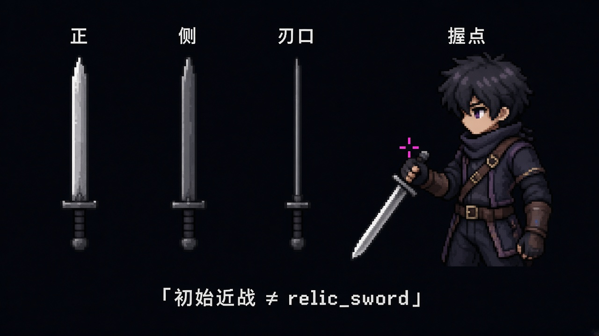

# 角色视觉锚点（暂定）

> 用途是提供可替换的角色外观配置。外观还未进入最终美术定稿；这里只规定剪影、服装和可替换装备外观，不规定最终像素画法。角色故事、记忆来源与战斗动作库互相独立；这里不指定角色必须使用什么技能。

现行路线是 imagegen 逐张生成完整角色帧（见 [通用绘制规范](通用绘制规范.md) 的 2026-09-27 路线变更说明）。剪影、服装和可替换装备外观仍按本文件规定，但不再用低细节 Blender 模型验证骨架；Blender 小样（V1/V2/V3）已于 2026-09-27 删除。角色模型、装备、通用动作片段和技能条件分别配置；更换外观不应隐式更换技能。

## 主角：岑（暂名）

- **剪影：** 中等身高、轻装、轮廓简洁；胸腹与腿部便于阅读，不使用过长披风遮挡攻击动作。
- **状态变化：** 可用待机、受击等表现当下精神状态；技能获取不要求改变身体动作骨架。
- **装备外观：** 初始近战已锁。形制图见[初始近战三视+握点](形制/初始近战-三视握点.jpg)，设定见[技能总览 · 初始近战形制（已锁）](../设定/技能总览.md#初始近战形制已锁)。初始近战 ≠ `relic_sword`（祁霜旧练习剑）。远程飞刃为占位设定，**Demo 不做**。角色模型按当前装配显示装备；基础动作片段单独维护。

初始近战三视+握点（刃厚全长一致；≠ relic_sword）

- **外观气质：** 轻装、轮廓简洁；任何角色外观均可调用兼容的基础动作。

### 可见件清单（同人闸）

2026-10-17 锁定。依据是[主角造型与像素制作规范](../../prototype/2d_pipeline/2026-09-26-主角造型与像素制作规范.md)第 1–4 节：第 1–3 节的识别与剪影仍有效，色值用第 4 节现行 22 色板（方案 B）。左 / 右按角色自身，不按画面左右。下面的次序就是闸门次序：缺件，或次序不对，即不过闸。像素画法仍不在本清单里。

1. **左肩朱红破围巾 + 黄铜扣。** 暗朱红破围巾从角色左肩的黄铜扣固定，沿身体左侧垂下一条主尾，最长略过膝；布尾是磨损裂口。围巾朱红 `#ad3026`。正面必须看见扣件和围巾主体。
2. **腰匣四枚记忆芯，色序锁死。** 腰带正中是黄铜记忆匣（四枚玻璃芯），深棕皮带、黄铜矩形扣。四芯在匣内，不是腰带散挂药瓶；散挂药瓶 = 不过闸。色序：琥珀 `#f4b448` → 绿 `#b4be86` → 象牙 `#f8edda` → 朱红 `#b5443a`。不得跳位、翻序。
   - **硬否决：** 不得用「右黄×1 / 左绿→青→红」或任意散挂瓶色序替代腰匣四芯。
3. **右鬓银白。** 墨黑短发，右鬓一缕银白从发际延伸至耳上，发束象牙 `#fcfbe9`。不扩大成整片白发。
4. **胸口环状缝合痕。** 骨白内衫（`#f2e2d4`）领口在胸骨处交叉；缝合痕在衣襟下方，衣服静止时露出一部分，受击或大动作时仍须在。不是项链，也不是徽章。
5. **右臂绷带 / 左臂护腕。** 右前臂米白交叠绷带，左前臂深棕护腕。正面不可互换；镜像用整帧水平翻转，不交换角色自身的左右。
6. **深墨蓝短外套。** 敞开，翻领略高于肩，下摆至大腿上段，左右两片尖角衣尾。
7. **深炭裤塞靴。** 裤脚收进深棕靴；靴头与靴底之间有浅灰米色分界。

初始近战形制另见[形制图](形制/初始近战-三视握点.jpg)与[技能总览 · 初始近战形制（已锁）](../设定/技能总览.md#初始近战形制已锁)；本清单只管角色外观件数与记忆芯色序。`slash` 每一帧都必须过本清单；`run` / `jump` 同样不得换件或改色序。

## 闻岚：视觉配置参考

- **剪影：** 稳重、略宽的肩线与扎实站姿；可选盾牌造型作为外观识别元素。
- **装备参考：** 裂纹圆盾，裂纹集中在盾面，轮廓要完整可辨；可作为任何满足持盾条件角色的装备外观。
- **默认气质：** 少做多余摆动，力量从腿和躯干传到盾面；动作类型由实际配置决定。

## 墨九：视觉配置参考

- **剪影：** 身形灵活，腰侧工具盒可作为外观识别元素；背包 / 挂件数量克制，避免遮挡手部动作。
- **装备参考：** 雷管盒在腰侧，单枚炸弹可被一只手完整拿出；可配置给任何满足工具握持条件的角色。爆炸物、引爆器和爆炸效果彼此分层。
- **默认气质：** 观察落点再投掷；具体操作动作不绑定使用者身份。

## 小禾：视觉配置参考

- **剪影：** 轻巧、四肢伸展范围大；绳镖与绳索卷盘可作为可换装备外观，但不决定角色技能。
- **装备参考：** 旧训练绳镖；握持手、飞出的绳镖和连接线分层。装备可配置给任何拥有钩索能力的角色；绳线可由程序根据端点生成。
- **默认气质：** 动作可表现为伸手探路、顺绳受力；技能动作本身不绑定使用者身份。

## 祁霜：视觉配置参考

- **剪影：** 利落、修长，服装下摆短；剑类外观轮廓清楚，避免长饰物干扰快速位移动作。
- **装备参考：** 旧练习剑（`relic_sword`），剑身体现训练用而非仪式重剑；作为可替换的剑类外观配置。这是祁霜锚物，不是主角的初始近战；开场 `slash` 按[初始近战武器](初始近战武器.md)画。
- **默认气质：** 重心低、动作线路短而准；短距突进和刺击是独立动作片段，可由满足条件的角色组合使用。

## 共用视觉辨识原则

- 角色外观锚点可以换装、换动作；每个角色使用动作库中的哪些动作由技能配置决定，本文件不锁定技能归属。
- 角色剪影首先区分：盾牌大面、雷管盒和投掷物、绳镖与绳线、短练习剑与低姿瞬步。
- 细节不要依赖颜色单独区分；灰度剪影下也应能认出装备。
- 技能特效按功能表现：格挡向外弹、爆破向外扩散、钩索沿锚点延伸、突进沿位移方向拉出残影；可替换颜色与材质皮肤，不依赖角色姓名。

## 现行 22 色板（方案 B）

主角横斩样板使用现行 22 色板（方案 B），定义在
[`prototype/2d_pipeline/v4/config/palette.candidate.json`](../../prototype/2d_pipeline/v4/config/palette.candidate.json)
（文件名仍带 `candidate`，改名后置）。
每个颜色带 `role`（用途名）、在帧 01 上的实际覆盖率和位置质心。

**决议：承认 v4 实测板为现行 22 色板（方案 B）**，并已回写 [`主角造型与像素制作规范`](../../prototype/2d_pipeline/2026-09-26-主角造型与像素制作规范.md) 第 4 节；旧设计意图色值作废案保留对照。其中 6 个深色 / 中性色
（外套蓝黑、腿部棕暗、衣摆暖暗、内衫阴影、外套下摆蓝黑、披风暗红）的用途名仍是根据质心位置推断的，用途名可以再改，hex 已是导出用色，以本板为准。

配色时已经实测出的三条结论，后续调整请直接依据它们，不要再凭直觉：

1. **颜色加多了图反而更不像像素画。** 色块平均宽度随色数单调下降：12 色约 4.06 / 5.66 px，24 色约 2.01 / 2.65 px，
   40 色约 1.69 / 2.19 px（两个数分别是帧 01 / 帧 05）。真实像素画一般需要 3–4 px 以上的色块宽。
   自动扩色只是把暗部渐变切成更多级，不会带来辨识力。
2. **纯黑不能进色板。** 帧上 11% 的“纯黑”是量化假象：源图真正纯黑的不透明像素只有 205 个。
   色板里留 `#171a23` 这类带蓝的深色即可，不要留 `#000000`。
3. **必须给衣料留一个带阴影的骨白中性色。** 早期版本没有 `#3a3130`（内衫阴影）时，
   芯·绿 `#b4be86` 被迫去抢衣摆的暗部，覆盖率从 3.90% 掉到定板后的 0.14%——
   身份锚点色一旦被当作阴影用，角色识别就失效了。

灰度剪影判读（上一条原则）仍然是主要手段；色板只负责让锚点色（芯·朱红、芯·琥珀、芯·绿、发束象牙）
在小尺寸下不被深色吞掉。其他角色的色板尚不存在，等各自样板做出来后再补。

**已拍板（方案 B）：** 以实测板为准。旧设计意图对照（废案）：外套基色曾用 `#27303D`、围巾 `#A9473F`、芯·绿 `#63A58E`；现行对应约为外套亮面 `#323643` / 外套蓝黑 `#171a23`、围巾 `#ad3026`、芯·绿 `#b4be86`。`build_sequence.py` 导出时已把不透明像素按最近色、无抖动贴回本板。重跑方式见 [`v4/config/README.md`](../../prototype/2d_pipeline/v4/config/README.md)。
