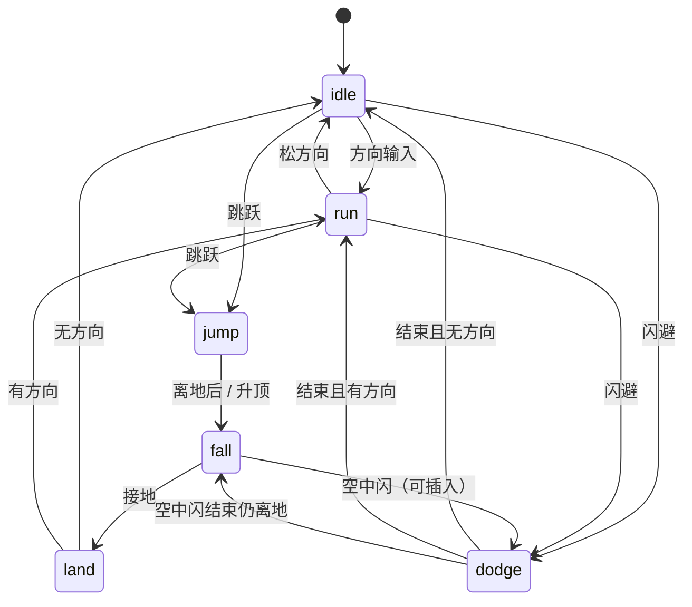

# 技能总览

本表描述可组合的技能模块，不是角色专属技能清单。角色剧情中的记忆来源只解释玩家从哪里学会能力；解锁之后由玩家 / 配置决定谁装备并使用。最终武器规格尚未定。冷却、资源与烛火公式也尚未定，**但不挡住 M1**。M1 状态机无资源：`run` / `jump` / `fall` / `land` / `dodge` / `slash`。信任 / 质疑的烛火抗性与预览代价公式随 M2 / 回点交付。

**2026-10-15：** 烛火消耗跟「解锁记忆来源 / 锚台」，不跟当前皮肤（与[故事框架](故事框架.md)一致）。**Demo 先砍开场远程**；下表远程行仅占位。现行可跑原型 clips：`idle`、`slash`（`prototype/2d_pipeline/v4/`）。里程碑做到哪一步只看故事框架，不在本文另列。

| 解锁记忆来源（非使用者） | 技能 / 动作片段 | 操作表达 | 战斗作用 | 探索 / 交互作用 | 需要的能力 / 装备条件 |
| --- | --- | --- | --- | --- | --- |
| 初始公共操作 · **M1** | 跑、跳、落、落地、闪（五动作链） | 方向、跳跃、闪避输入 | 走位、躲避 | 跨越普通平台 | 见下文 M1；无专属装备条件 |
| 初始公共操作 | 近战：当前可交付 `slash`（横斩）。上挑、下劈为后期 | 攻击（当前一段） | 输出 | 无 | 当前只排 `slash`；挑 / 劈不进当前交付 |
| 初始公共操作（占位 · **Demo 不做**） | 远程投掷 | 面向目标后投掷 | 远距离牵制 | 无 | 投掷动作；需要可投掷物和对应手部挂点；Demo 砍掉，不排帧 |
| 闻岚记忆解锁 | 举盾 / 完美盾反 | 按住防御 / 合适时机点按 | 承受正面攻击、成功时弹开攻击并制造硬直 | 挡住标记投射机关 | `relic_shield=true`（关中拾取的永久旗标；帧内画出盾，不运行时换装） |
| 墨九记忆解锁 | 投掷爆炸物 / 主动引爆 | 瞄准后投掷，可主动引爆 | 范围伤害、打断群敌、连锁爆破 | 炸开有裂纹标识的薄弱障碍 | 需要投掷物、投掷槽位和引爆信号；不绑定特定角色 |
| 小禾记忆解锁 | 钩索 / 标记墙攀附 | 锁定锚点发射；在标记墙抓附 | 拉近轻型敌人、抵达空中目标、脱离包围 | 跨断层、攀上标记墙、翻越高台 | 需要钩索挂点 / 可攀附能力；绳索与角色分层 |
| 祁霜记忆解锁 | 瞬步（`blink`）+ 刺击 | 窄缝步；成功后的追击窗口内刺击 | 贴近并反击 | 越过短距裂隙。`blink` 不是 `dodge` | 永久解锁旗标；刺击外观画在帧里 |
| 祁霜记忆解锁 | 地图显影 | 满足探索进度后启动 | 不造成伤害 | 显示未探索布局和已发现重点 | UI 表现，不依赖特定角色动作 |

**`dodge` ≠ `blink`：** `dodge` = 无敌帧翻滚；`blink` = 窄缝瞬步（祁霜）。「弹反追击」只是 `blink` 之后的追击窗口，不是单独技能。祁霜侧只记「瞬步 + 刺击」和「地图显影」。

## 装配原则

- “解锁记忆来源”是叙事来源，不代表技能永久绑定该角色的外观。
- **烛火消耗绑定解锁来源对应的记忆锚台**，不绑定当前皮肤：装备闻岚记忆解锁的盾反时，消耗记在闻岚烛上，即使画面是岑持盾。
- 角色能否使用某技能由能力 / 装备条件判断。早期这些条件是永久解锁旗标（盾反看 `relic_shield`，不看运行时是否换上另一面盾）；不要按角色姓名写死。
- 角色待机、移动、受击等公共动作由底层状态机复用；技能在需要时调用相应动作片段，并组合独立的逻辑与特效。
- 一项技能可由多个动作片段组成；同一个动作片段可被多项技能或多名角色调用。
- 地图显影属于界面能力，不占用角色战斗动作槽；纯浏览不耗烛，若强化绑定该记忆则记祁霜锚台。

## 当前仍需后续确定

- 主角初始近战武器形制（Demo 无远程；远程形制可后置）。
- 防御、瞬步、钩索的最终按键。冷却 / 资源 / 烛火的具体公式仍未定，但不挡 M1，随 M2 / 回点交付。
- 关卡中锚点、攀爬墙、可炸墙的图标规范。
- 最终美术风格、像素密度和游戏内角色占屏尺寸。
- **色板：** 2026-10-15 拍板采用现行 22 色板（方案 B），文件仍为 [`palette.candidate.json`](../../prototype/2d_pipeline/v4/config/palette.candidate.json)，已回写造型规范第 4 节；仍待接进 `build_sequence.py` 导出。详见[角色视觉锚点](../美术/角色视觉锚点.md)。

这些未定项不会妨碍先画通用白盒动作姿势；定稿时只需为动作指定模型、装备适配器和参数，不改动技能与角色的解耦关系。

**现行原型已交付的 clip：** `idle`、`slash`。M1 及之后的排帧顺序以故事框架的里程碑表为准。

## M1 五动作链

M1 补开场教学用的五段公共动作（对应[关卡清单 Beat 0C](关卡与场景清单.md#beat-0c--结界初醒与教学--demo--对应-m1)）。主干链：**跑 → 跳 → 落 → 落地**；**闪**可从 `idle` / `run` / `fall` 插入。下表是技能侧的动作与 clip 约定；**里程碑是否完成只改[故事框架](故事框架.md)**。

**无资源：** 这条状态机是 `run` / `jump` / `fall` / `land` / `dodge` / `slash`（外加已有 `idle`）。冷却、资源条、烛火燃烧公式不在 M1 验收里，也不挡住排这五段帧。信任 / 质疑抗性与预览代价公式随 M2 / 回点交付。

| 顺序 | 动作 | 动作文档 | clip（约定，尚未导出） | Beat 0C 教学用途 |
| --- | --- | --- | --- | --- |
| 1 | 跑 | [奔跑循环](../美术/动作/基础移动/2026-09-25-奔跑循环.md) | `run` | 横向到缺口 / 出口光 / 回点光路 |
| 2 | 跳 | [起跳](../美术/动作/基础移动/2026-09-25-起跳.md) | `jump` | 越过一小段缺口（离地后只进 fall） |
| 3 | 落 | [下落循环](../美术/动作/基础移动/2026-09-25-下落循环.md) | `fall` | 空中态；可插闪 |
| 4 | 落地 | [落地](../美术/动作/基础移动/2026-09-25-落地.md) | `land` | 缓冲后接 idle 或 run |
| 5 | 闪 | [闪避翻滚](../美术/动作/基础移动/2026-09-25-闪避翻滚.md) | `dodge` | 躲开教学木桩慢攻（可选） |

**已有 / 不做：** 现行可跑原型已有 `idle`、`slash`（`prototype/2d_pipeline/v4/`）。Demo **无远程**；远程行仅占位，不排帧。`run` / `jump` / `fall` / `land` / `dodge` 都还没有帧，也不在 `v4/godot/assets/manifest.json` 里。导出文件位见[设计资产挂接](../美术/设计资产挂接.md) §2.1。

### 状态机衔接（设计约定，非代码）

| 当前 clip | 可转入 | 触发（设计语义） |
| --- | --- | --- |
| `idle` | `run` / `jump` / `dodge` / `slash` | 方向 / 跳 / 闪 / 近战 |
| `run` | `idle` / `jump` / `dodge` | 松方向 / 跳 / 闪 |
| `jump` | `fall` | 离地关键帧后或升顶；**不可**直接闪（闪从 `fall` 插） |
| `fall` | `land` / `dodge` | 接地 / 空中闪 |
| `land` | `idle` / `run` | 落地收势结束；按是否仍有方向 |
| `dodge` | `idle` / `run` / `fall` | 翻滚结束：着地→idle/run；仍离地→fall |
| `slash` | `idle`（默认） | 攻击收势；M1 不要求从 slash 切五动作链 |

主干口诀：**跑→跳→落→落地**；落地回 `idle` 或 `run`；闪结束回 `idle` / `run`（或仍离地则 `fall`）。

### 取消窗（高层面，不定数值）

- **跑循环**：任意循环点可切跳 / 闪；松方向回 `idle`。
- **起跳**：一旦离地只进 `fall`；闪从 `fall` 插（不从 `jump` 直插），避免双输入竞态。
- **下落**：全程可插闪；接地优先切 `land`（闪未起手时）。
- **落地**：收势前半不可切跑以外的动作；收势末可接跑 / 待机。闪不从 `land` 中段插入（等回 idle/run 再闪）。
- **闪避**：翻滚中段（约姿势 2–4）为无敌参考窗；结束前不可再闪、不可切跳；可被程序强制切 `fall`（平台掉下）。
- 具体帧号 / ms 由程序与导出帧数定；本文只锁**谁能切谁**。

**设定侧验收（故事框架把 M1 标完成时）：** Beat 0C 能连续跑→跳→落→落地，并用闪躲过至少一次攻击或提示；近战用已有 `slash`。色板方案 B 接进 `build_sequence` 后再批量出这五段帧，避免双色标准。

## 动画制作与游戏运行的分工

- 动作文档规定身体姿势、动作顺序和装备接触点；现行主干是 imagegen 逐张生成完整动作帧，由 `v4/build_sequence.py` 对齐、检查、排成每动作一张精灵表（2026-09-27 起，替代原 Blender 共用骨架路线）。
- 角色外观与动作片段在文档上分开维护。早期「装备条件」= 永久解锁旗标；现行帧把装备画进画面，不做运行时换装。预渲染只覆盖实际出场的组合。
- Godot 负责读取并播放动作帧；移动、攻击判定、解锁和技能兼容条件由游戏逻辑配置，不烘焙到图像里。冷却与资源公式不进 M1。
- AI 生图在当前路线里就是正式动作帧的来源，但必须先通过构建脚本的一致性门禁（角色占比、脚底锚点、色块宽、帧间色偏），门禁不通过不导出。手工修帧仍用 CSP / Pixelorama，Blender 保留为备选路线。
